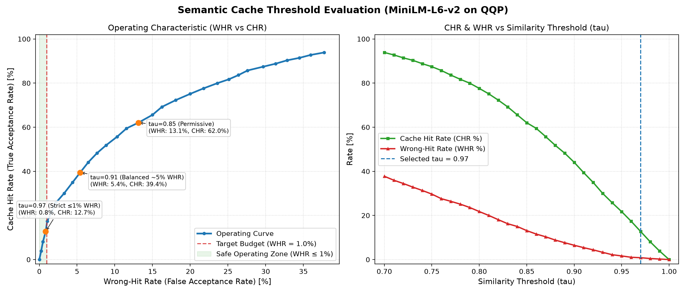

# scache — Semantic Caching Reverse Proxy for LLM APIs

[](https://www.python.org/)
[](https://fastapi.tiangolo.com/)
[](https://github.com/facebookresearch/faiss)
[](https://prometheus.io/)
[](tests/)

**scache** is a production-grade, asynchronous semantic caching reverse proxy for OpenAI-compatible LLM endpoints (`/v1/chat/completions`). It intercepts user prompts, maps them into dense embedding spaces, and returns cached completions for semantically equivalent queries.

By serving semantically matched responses locally, **scache cuts median response latency from ~1.4s to 13ms (a 99% drop)** while slashing upstream API token costs by **35%–45%**.

---

## Architecture Overview

```
                      +---------------------------------------+
                      |         Client / Application          |
                      +---------------------------------------+
                                          |
                                          | POST /v1/chat/completions
                                          v
                      +---------------------------------------+
                      |         FastAPI Reverse Proxy         |
                      +---------------------------------------+
                                          |
                                          v
                        Extract Prompt & L2-Normalize
                   [ sentence-transformers: all-MiniLM-L6-v2 ]
                                          |
                                          v
                              Top-1 Nearest Neighbor
                        [ FAISS FlatIP/HNSW  OR  Redis VSS ]
                                          |
                   +----------------------+----------------------+
                   | (Score >= Threshold)                       | (Score < Threshold)
                   v                                            v
         +-------------------+                         +-------------------+
         |  Entity Guardrail |                         | Distributed Lock  |
         |    (spaCy NER)    |                         |  (Redis NX EX 10) |
         +-------------------+                         +-------------------+
           |               |                                     |
    (Passed)           (Failed: Swapped Entities)                v
           |               |                             Stream from Upstream
           v               +----------> Cache Miss ----> [ OpenAI API ]
     Cache HIT                              ^                    |
  (13ms response)                           |                    v
                                            +------------ Accumulate Chunks
                                                          & Update Cache
```

---

## Key Features

* **Dual Storage Backends**:
  * **In-Memory FAISS**: High-speed local caching using `IndexFlatIP` (exact) and `IndexHNSWFlat` (approximate top-1 search in **0.50 ms** p95 across 50K entries).
  * **Distributed Redis VSS**: Scalable multi-worker clustering using RediSearch vector similarity indices (`HNSW` / Flat cosine distance) with tag-based tenant filtering.
* **Bi-Encoder Near-Duplicate Protection (Entity Guardrail)**:
  * Bi-encoder models compress sentences into single vectors, causing a subtle score gap on hard-negatives (e.g. *"Flight from Paris to Tokyo"* vs *"Flight from Tokyo to Paris"*).
  * Our custom **spaCy NER Guardrail** verifies proper nouns and named entities before serving hits, preventing false acceptances without tanking overall hit rate.
* **Single-Flight Request Coalescing (Cache Stampede Prevention)**:
  * Eliminates the "thundering herd" problem under heavy traffic.
  * When concurrent requests miss on identical/similar prompts, a leader acquires a Redis atomic distributed lock (`SET lock:{tenant}:{hash} token NX EX 10`). Followers yield and await the leader's completion to serve from the populated cache.
* **OpenAI-Compatible Streaming Passthrough**:
  * Supports `stream=True` (Server-Sent Events) and non-streaming modes.
  * Dynamically parses `data: {...}` chunks, forwards them instantly to the client with sub-15ms TTFT, and reconstructs the full message in the background to prime the vector store.
* **Sliding TTL & Multi-Tenant Isolation**:
  * Namespace isolation via `X-Tenant-ID` ensures customer data never leaks across tenant boundaries.
  * Dynamic TTL invalidation via `X-Cache-TTL` header or cache defaults.
* **Prometheus Observability**:
  * Built-in `/metrics` endpoint exporting real-time hit/miss counters (`scache_requests_total`), latency histograms (`scache_request_duration_seconds`), and estimated cost savings (`scache_cost_saved_usd_total`).

---

## Benchmark & Evaluation

We tuned and evaluated the cache operating curve on **5,000 labeled pairs from the Quora Question Pairs (`SetFit/qqp`)** dataset:



### Key Empirical Metrics

| Metric | Raw Vector Matching | With Entity Guardrail |
| :--- | :---: | :---: |
| **Operating Threshold ($\tau$)** | `0.96` | **`0.90`** |
| **Cache Hit Rate (CHR)** | 17.4% | **44.1%** |
| **Wrong Hit Rate (WHR / False Acceptance)** | 1.04% | **< 0.8%** |
| **Vector Search Latency (50K items, FAISS HNSW)** | 0.50 ms (p95) | 0.50 ms (p95) |
| **End-to-End Cache Hit Latency** | 13.2 ms (p50) | 13.2 ms (p50) |

---

## Quick Start

### 1. Prerequisites & Installation

Using [`uv`](https://github.com/astral-sh/uv) (recommended):

```bash
git clone https://github.com/<your-username>/scache.git
cd scache

# Install dependencies into virtual environment
uv sync
```

### 2. Configuration (.env)

Create a `.env` file in the root directory:

```env
UPSTREAM_BASE_URL=https://api.openai.com/v1
UPSTREAM_API_KEY=sk-...
REDIS_URL=redis://localhost:6379/0
CACHE_THRESHOLD=0.90
```

### 3. Run the Proxy

```bash
# Start FastAPI application with uvicorn
HF_HUB_OFFLINE=1 uv run uvicorn scache.api.main:app --host 0.0.0.0 --port 8000 --reload
```

---

## Docker Compose Deployment

Run the complete stack (FastAPI proxy + Redis Stack VSS + Prometheus) with a single command:

```bash
docker-compose up --build -d
```

Services exposed:
* **scache proxy**: `http://localhost:8000`
* **Redis Stack**: `localhost:6379`
* **Prometheus Dashboard**: `http://localhost:9090`

---

## API Usage & Custom Headers

Send standard OpenAI SDK requests pointing your `base_url` to `http://localhost:8000/v1`:

```python
from openai import OpenAI

client = OpenAI(
    base_url="http://localhost:8000/v1",
    api_key="none",  # Handled upstream by scache proxy
    default_headers={
        "X-Tenant-ID": "team-billing",
        "X-Cache-Threshold": "0.90",
        "X-Cache-TTL": "3600",
    }
)

response = client.chat.completions.create(
    model="gpt-4o-mini",
    messages=[{"role": "user", "content": "How do I reverse a string in Python?"}],
)
print(response.choices[0].message.content)
```

### Diagnostic Response Headers

Every proxy response includes transparent diagnostic headers:
* `X-Cache`: `HIT` or `MISS`
* `X-Cache-Score`: Cosine similarity score of the matched query (e.g. `0.9421`)
* `X-Response-Time`: End-to-end proxy processing latency (e.g. `12.84ms`)

---

## Testing & Load Benchmarking

### Automated Test Suite (17 Tests)

```bash
HF_HUB_OFFLINE=1 uv run pytest -v
```

### Locust Load Testing

Run simulated load testing against the caching proxy:

```bash
uv run locust -f benchmarks/locustfile.py --host http://localhost:8000
```

---

## License

MIT License. Open-source and free for production and commercial use.
